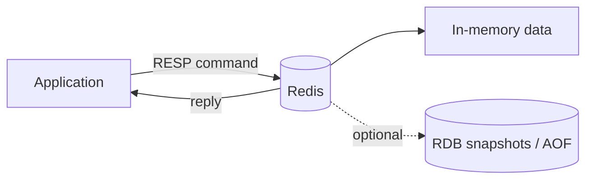

# 1. Redis fundamentals

## Mental model

Redis is a networked, in-memory data-structure store. A client sends commands using RESP; Redis executes each command against keys and values and returns a reply. Most commands are fast because data is in memory, but network latency, large values, persistence, and slow commands still matter.

Redis command execution is largely serialized; Redis 6+ can use I/O threads for parts of network processing. A single slow command can delay other clients, so avoid unbounded work on the server.



## Data types and typical uses

| Type | Useful commands | Common use |
|---|---|---|
| String | `GET`, `SET`, `INCR`, `MGET` | Cache values, counters, locks, tokens |
| Hash | `HGET`, `HSET`, `HINCRBY` | Small object-like records |
| List | `LPUSH`, `RPOP`, `LRANGE` | Simple FIFO/LIFO; use Streams or a queue library for durable work |
| Set | `SADD`, `SISMEMBER`, `SINTER` | Uniqueness, membership, set operations |
| Sorted set | `ZADD`, `ZRANGE`, `ZREM` | Rankings, scheduled timestamps, sliding-window logs |
| Stream | `XADD`, `XREADGROUP`, `XACK` | Append-only events and consumer groups |
| Bitmap / HyperLogLog | `SETBIT`, `PFADD`, `PFCOUNT` | Compact flags / approximate distinct counts |

Complexities are command-specific: string get/set and hash field access are generally O(1); sorted-set updates are O(log N); range commands cost at least O(number of returned items). Check the command reference for the exact operation.

## Keys, expiry, and safe operations

Use namespaced, bounded keys such as `user:42`, `cache:users:v1`, or `otp:login:<opaque-id>`. Avoid raw sensitive values, unbounded user input, and huge keys.

```redis
SET cache:product:42 '{"name":"keyboard"}' EX 60
SET session:abc123 active EX 300 NX
INCR rate-limit:account:42
TTL rate-limit:account:42
```

- `EX` sets a TTL in seconds; `PX` uses milliseconds. Expiry is removed when a key expires or is evicted.
- `NX` means “only if absent”; `XX` means “only if present.” Use a single atomic command when possible.
- Use `SCAN` in production tooling instead of `KEYS *`, which can block while scanning a large keyspace.
- `DEL` frees memory synchronously; `UNLINK` unlinks keys and frees large values asynchronously.
- Keep key cardinality and value sizes bounded. Avoid storing large JSON blobs when fields can be fetched separately.

## Transactions and atomicity

Individual Redis commands are atomic. `MULTI`/`EXEC` groups commands without interleaving, but does not provide rollback for runtime command errors. Lua scripts run atomically and are useful when a decision and update must be indivisible. Atomicity does not imply durability or cross-system transactions.

## Memory and eviction

Redis is memory-first. Plan for data plus allocator overhead, replication buffers, client buffers, and persistence workspaces. Set `maxmemory` deliberately and choose an eviction policy:

- `noeviction`: reject writes at the limit; often preferred when losing queue or authoritative data is unacceptable.
- `allkeys-lru` / `allkeys-lfu`: evict any key, favoring recently / frequently used keys.
- `volatile-lru`, `volatile-lfu`, `volatile-ttl`: evict only keys with an expiry.

Eviction is not a substitute for application TTLs. Monitor memory, evictions, keyspace hits/misses, latency, connected clients, and rejected commands.

## Persistence and availability

- **RDB**: point-in-time snapshots; compact and fast to restore, but writes since the last snapshot can be lost.
- **AOF**: records write operations; `appendfsync everysec` is a common durability/throughput compromise. AOF can be larger and require rewrite.
- **Replication**: primary sends changes to replicas asynchronously. Replicas improve read capacity and recovery options, but may lag.
- **Sentinel**: monitors non-clustered primary/replica deployments and coordinates failover.
- **Cluster**: shards keys across 16,384 hash slots and supports replica failover. Multi-key operations generally require keys in the same slot; hash tags such as `{user:42}:profile` can co-locate related keys.

Redis replication is asynchronous by default: a successful reply does not guarantee a write has reached every replica or disk. Pick persistence and failover settings based on acceptable data loss.
