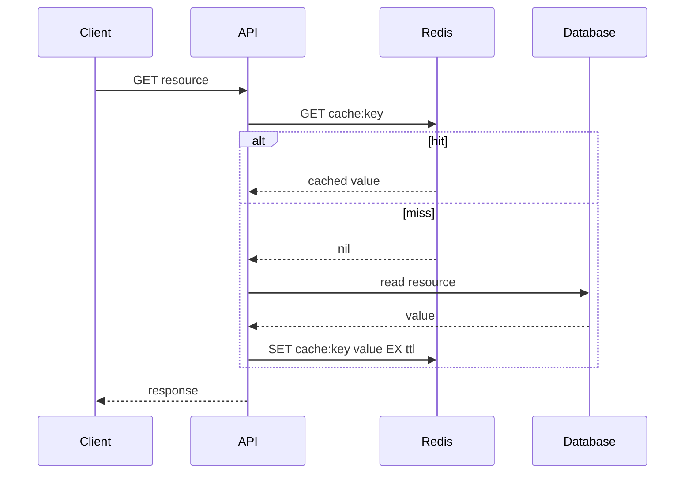

# 2. Caching with Redis

## Cache-aside (lazy loading)

The application checks Redis, loads from the source of truth on a miss, then stores a serialized result for a bounded time.



Example with node-redis:

```js
const key = `cache:user:${userId}`;
const cached = await redis.get(key);
if (cached !== null) return JSON.parse(cached);

const user = await User.findById(userId).select("-password");
if (user) await redis.set(key, JSON.stringify(user), { EX: 60 });
return user;
```

Use the source of truth for writes; cache only data that can be rebuilt. Use a schema/version in keys when serialization or meaning changes.

## Write and invalidation choices

- **Cache-aside**: app loads and invalidates. Flexible, but invalidation must be correct.
- **Read-through**: a cache layer loads misses. Centralizes loading; couples the cache layer to the source.
- **Write-through**: write source and cache synchronously. Reads are fresh after success, but writes add latency and cross-store partial failure remains possible.
- **Write-behind**: acknowledge cache writes and persist later. Fast, but can lose acknowledged data; only use with explicit durability/replay design.

For mutable records, invalidate after a successful source write or update the cache consistently. TTL bounds stale data but does not replace correct invalidation. Avoid invalidating before a source write that might fail.

## Common failure modes

| Problem                                     | Mitigation                                                                                                 |
| ------------------------------------------- | ---------------------------------------------------------------------------------------------------------- |
| Cache stampede: many misses for one hot key | Per-key single-flight, short distributed lock, or stale-while-revalidate                                   |
| Hot-key overload                            | Local near-cache, request coalescing, replicas, or key sharding                                            |
| Large synchronized expiry wave              | Add TTL jitter, e.g. base TTL plus a small random offset                                                   |
| Cache outage                                | Choose deliberately: serve from source with limits, or fail with 503; protect the source from a miss storm |
| Stale or poisoned entries                   | Validate cached shape/version, use safe serialization, invalidate on writes                                |
| Unbounded cache growth                      | TTLs, size limits, eviction policy, and memory monitoring                                                  |

Example TTL jitter: choose a random expiry in `[base, base + jitter]` rather than assigning the same TTL to every item.

## Consistency checklist

1. Name the source of truth.
2. Define acceptable staleness and TTL.
3. Define cache behavior during Redis failure.
4. Invalidate or refresh only after a successful source write.
5. Track hit/miss ratio, read/write latency, evictions, and fallback load.
6. Never cache secrets or sensitive fields by default.
