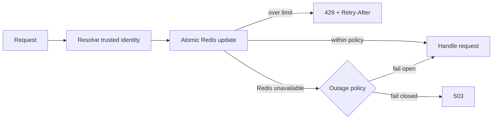

# 4. Rate limiting

Rate limiting protects a service or dependency from excessive traffic. Choose the identity (account, API key, IP, or a combination), policy, and Redis-outage behavior explicitly. Behind a proxy, trust forwarded IP headers only from known proxy hops.

## Algorithms

| Algorithm | Redis shape | Strength | Limitation |
|---|---|---|---|
| Fixed window | `INCR` + expiry per window | Simple and cheap | Boundary burst can allow nearly 2× the nominal rate |
| Sliding log | Sorted set of request timestamps | Accurate rolling window | Stores each request; more memory and work |
| Sliding counter | Current and previous bucket counters | Smooth approximation, low memory | Approximate near boundaries |
| Token bucket | Token count + last-refill time | Allows controlled bursts and steady rate | Requires atomic refill/consume logic |
| Leaky bucket | Queue or virtual schedule | Smooth output rate | Can add latency or reject bursts |

## Fixed-window counter

The counter increment and first expiry must be atomic, otherwise a crash between `INCR` and `EXPIRE` can leave a permanent key. Use a Lua script:

```lua
local n = redis.call("INCR", KEYS[1])
if n == 1 then redis.call("EXPIRE", KEYS[1], ARGV[1]) end
return n
```

For a 60-second window and limit of 100, permit counts `1..100`, then return `429 Too Many Requests`. Set `Retry-After` from the remaining TTL. Keep counters bounded with expiry.

## Sliding-window log

Use a sorted set whose score is the request timestamp. Atomically remove old entries, count current entries, conditionally add the new request, and set a key TTL in Lua. This is precise but uses O(requests in the active window) memory.

## Design and operations

- Use atomic Lua or transactions; a client-side `GET`, then `INCR` is race-prone.
- Normalize identity; do not trust arbitrary user-controlled key strings.
- Use hash tags for related Lua keys in Redis Cluster.
- Decide fail-open vs fail-closed. For expensive or security-sensitive endpoints, a `503` when Redis is unavailable may be safer than unlimited traffic; for low-risk endpoints, local fallback may be acceptable but is not globally consistent.
- Set limits per operation and account tier; distinguish burst allowance from sustained rate.
- Emit `429` with a retry hint; monitor allowed, rejected, and Redis-error counts.
- Rate limiting is not authentication, authorization, bot defense, or a DDoS boundary by itself.



## Node-redis atomic counter example

For a simple fixed window, Lua keeps increment and first expiry atomic:

```js
const script = `
  local n = redis.call("INCR", KEYS[1])
  if n == 1 then redis.call("EXPIRE", KEYS[1], ARGV[1]) end
  return n
`;
const count = await redis.eval(script, {
  keys: [key],
  arguments: ["60"],
});
```

For more complex policies, keep the full decision in one server-side script and test it against the deployed Redis version.
