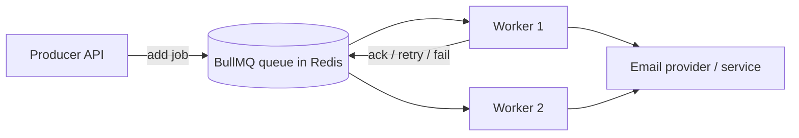
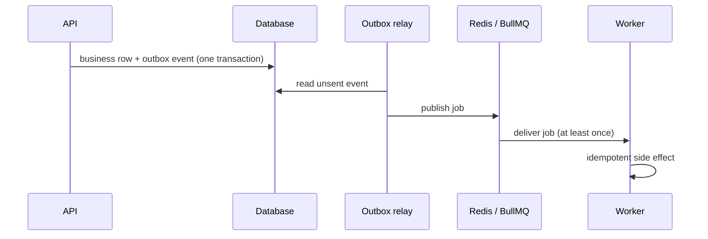

# 5. Background jobs with BullMQ

Use a queue when work can finish after the HTTP response or needs retries, rate control, or independent worker scaling. Redis stores queue state; BullMQ supplies job scheduling, locks, retries, and worker coordination.



## Minimal pattern

Producer:

```js
import { Queue } from "bullmq";
import IORedis from "ioredis";

const connection = new IORedis(process.env.REDIS_URI || "redis://localhost:6379", {
  maxRetriesPerRequest: null,
});
const emailQueue = new Queue("email", { connection });

await emailQueue.add(
  "welcome",
  { userId: "user-42" },
  {
    attempts: 5,
    backoff: { type: "exponential", delay: 1000 },
    removeOnComplete: 1000,
    removeOnFail: 1000,
  },
);
```

Worker:

```js
import { Worker } from "bullmq";
import IORedis from "ioredis";

const connection = new IORedis(process.env.REDIS_URI || "redis://localhost:6379", {
  maxRetriesPerRequest: null,
});
const worker = new Worker(
  "email",
  async (job) => deliverEmail(job.data.userId),
  { connection, concurrency: 10 },
);
```

Keep jobs small; store IDs or references instead of large or sensitive payloads. Validate job data in the worker, which is an independent process and may run much later.

## Delivery semantics and reliability

- Expect **at-least-once** processing: a worker can finish a side effect and crash before acknowledging. Make handlers idempotent (for example, provider idempotency key or a unique processed-job record).
- Retry only transient errors. Use bounded attempts and exponential backoff with jitter; permanent errors should fail promptly.
- A failed job is not automatically a dead-letter workflow. Retain, inspect, alert, and provide a controlled replay path.
- Use deterministic job IDs to deduplicate only when that matches product semantics; a reused ID can prevent a new job from being added.
- Configure concurrency and provider rate limits to protect dependencies. Avoid doing CPU-heavy work on the event loop.
- Handle stalled jobs and graceful shutdown. Stop accepting new work, close the worker, then close connections.
- Monitor waiting, active, delayed, failed, and stalled jobs; queue age is often more useful than queue length.

## Database write + queue enqueue

Writing a database row and adding a Redis job are not one transaction. If the process crashes between them, work can be lost; if it retries, duplicate jobs may occur.

For critical workflows, use a **transactional outbox**: write the business change and an outbox event in one database transaction; a relay publishes events to BullMQ and marks them sent. Make the consumer idempotent.



Redis persistence, memory policy, and backups matter when queue data is important. Do not treat an evictable cache as a durable job log.
