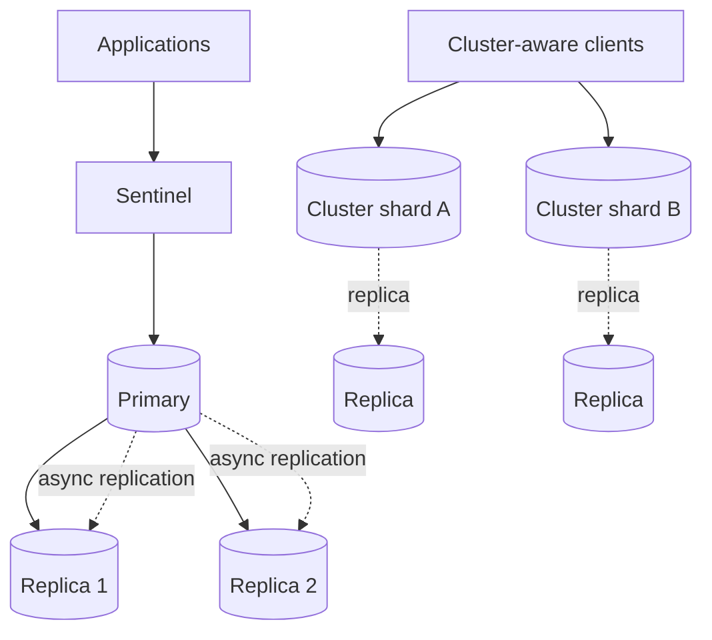

# 6. Redis in system design

## Choose the role first

| Role | Source of truth? | Typical policy |
|---|---|---|
| Rebuildable cache | No | TTLs + an eviction policy; tolerate misses |
| Session / temporary challenge | Sometimes | Explicit TTL, replication, controlled failure behavior |
| Rate-limit state | No, but affects protection | Atomic updates; define fail-open/closed behavior |
| Queue state | Operationally important | Avoid eviction; persistence/replication and recovery plan |
| Primary data store | Yes | Requires explicit durability, backup, failover, and consistency design |

Do not combine unrelated workloads blindly. A cache stampede or memory pressure should not evict queue state or OTPs.

## Topology choices

| Topology | Use when | Trade-off |
|---|---|---|
| Single instance | Development or small workload | Simple; one capacity and failure domain |
| Primary + replicas + Sentinel/managed failover | Need HA without sharding | Replication is async; failover may lose recent writes |
| Redis Cluster | Dataset or throughput exceeds one node | Client must handle redirects, slots, and multi-key slot rules |
| Managed Redis | Prefer provider operations | Understand provider durability, network, failover, and cost guarantees |

Sentinel performs monitoring and failover but does not shard data. Cluster shards by hash slot and has its own failover. Neither makes Redis a strongly consistent database.

## Capacity and performance

Estimate:

`memory ≈ live key/value bytes + per-key/object overhead + fragmentation + client/replication buffers + persistence headroom`

Then load-test realistic key cardinality, value sizes, TTL churn, and concurrency. Measure p50/p95/p99 latency, command mix, memory, evictions, replication lag, rejected writes, and queue age.

- Use pipelining to reduce round trips when commands are independent.
- Use `MGET`/`MSET` or hashes where they reduce network calls without creating giant hot objects.
- Avoid `KEYS`, huge range reads, unbounded Lua, and large values.
- A Redis command is usually atomic, but a long command/script blocks other command execution.
- Scale reads only when stale replica reads are acceptable.

## Failure and consistency decisions

Ask before launch:

1. Is Redis unavailable? Cache fallback, `503`, or local approximation?
2. What acknowledged data can be lost on failover?
3. What happens when `maxmemory` is reached?
4. Can jobs be reconstructed, retried, or replayed?
5. Are multi-key operations compatible with Cluster slot placement?
6. How will operators inspect, back up, restore, and rotate credentials?

Use timeouts, bounded retries with backoff, circuit breakers, and load shedding. Avoid retry storms. For cache outages, protect the database from a sudden full miss. For OTPs and rate limits, fail-open may weaken security; decide explicitly. For queues, reconcile against a durable outbox if losing work is unacceptable.

## Security and operations

- Bind Redis to trusted interfaces; firewall it and keep it off the public internet.
- Use ACL users with least privilege, TLS where appropriate, and managed secret storage.
- Do not use the default user or put credentials in source, shell history, URLs in logs, or committed `.env` files.
- Separate dev/staging/prod, use key prefixes, and set memory limits.
- Monitor slow commands, latency, memory, evictions, connections, replication health, rejected writes, and queue backlog.
- Practice failover, restore, and credential rotation. A green health check should test dependencies at the level the service requires.
